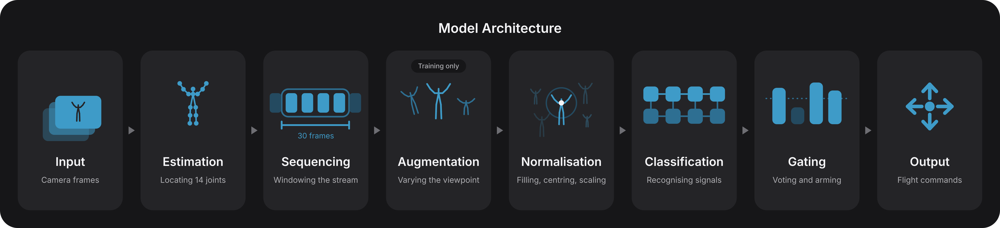
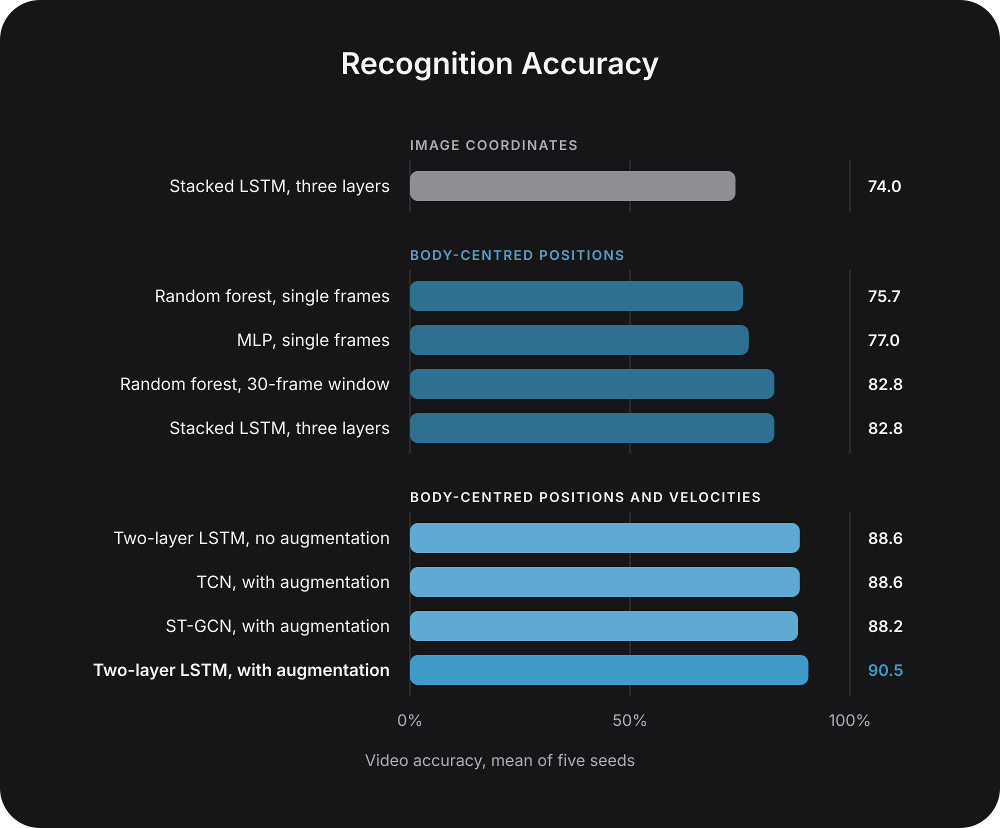
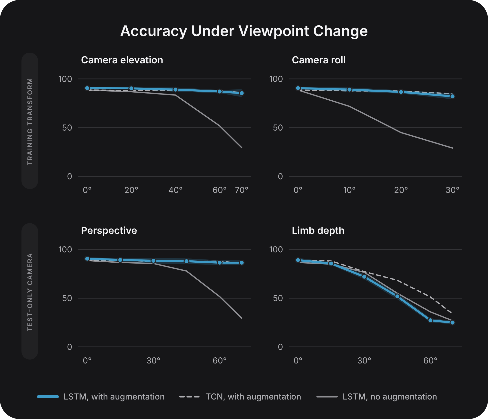
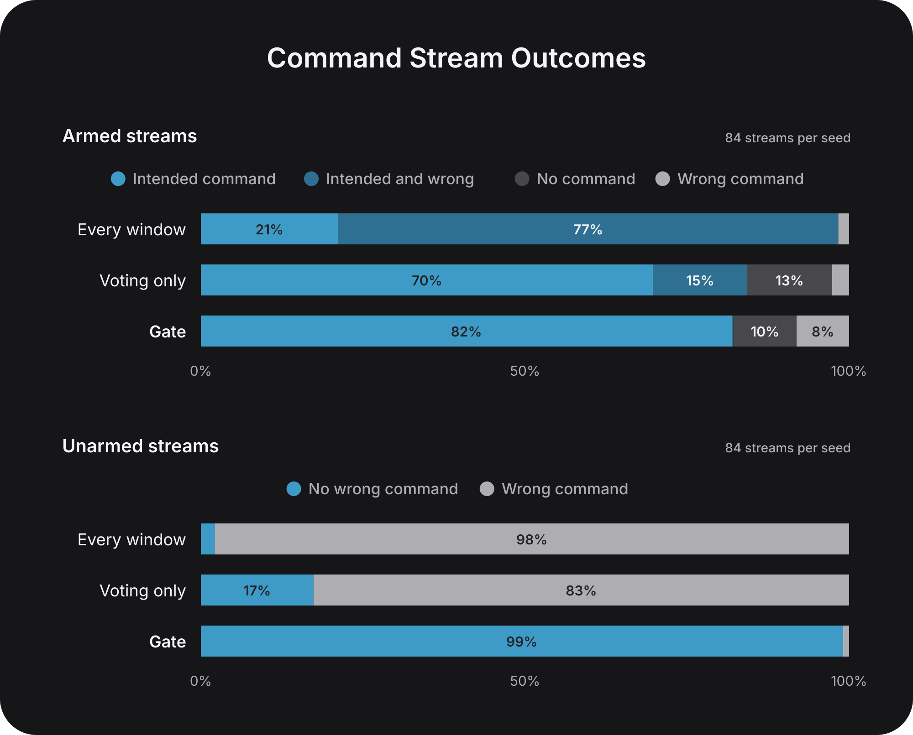
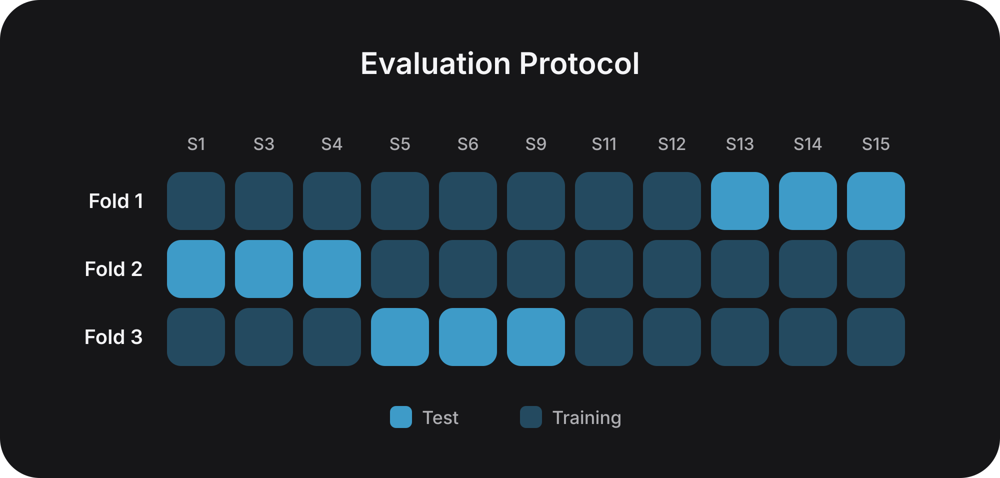
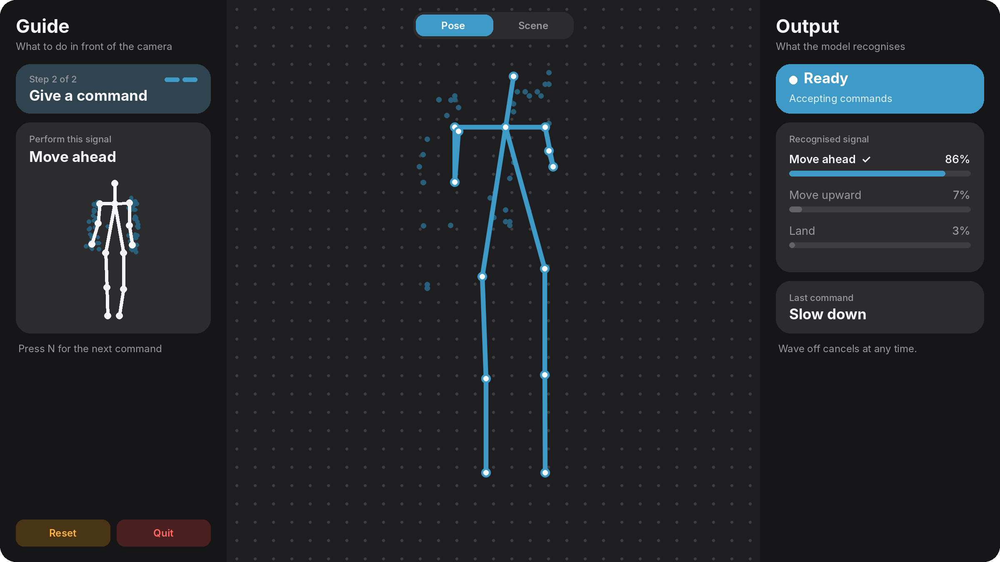

# Aerial Signal Recognition


Aerial Signal Recognition is a compact model that recognises the aircraft-handling body signals of a person on the ground from the camera of an unmanned aerial vehicle (UAV), and decides when the UAV should act on them. It reads body keypoints from any 2D pose estimator, recognises 13 standard signals such as hover, land and wave off, and turns them into flight commands only when a signal is deliberate and stable. It was built for search and rescue, where a responder may need to direct a UAV without a radio or controller.

## How It Works



**Input.** Frames from the UAV's camera, at any frame rate. The model never sees the images themselves.

**Estimation.** A 2D pose estimator locates 14 body joints in each frame. Any estimator that gives these joints can be used, which keeps the model independent of the camera and the image quality.

**Sequencing.** The keypoints are resampled to 25 Hz, and every 0.2 seconds the last 30 frames, 1.2 seconds of movement, form one window.

**Augmentation.** In training only, each window is shown as a UAV might have seen it, with the camera tilted or rolled, joints missing or the frame rate lowered. This is what keeps the model accurate when the viewpoint changes.

**Normalisation.** Missing joints are filled in, the body is centred on the neck and scaled by the length of the torso, and the velocity of each joint is added. The model then responds to how the body moves rather than where it stands in the frame.

**Classification.** A two-layer LSTM reads the window and gives a probability for each of the 13 signals. It has 229,117 parameters and updates frame by frame, so it suits a computer on board the UAV.

**Gating.** A signal is accepted only when it wins 6 of the last 8 windows with a mean confidence of at least 0.7. The attention signal arms the gate and the next accepted signal becomes a command, while the abort signal is always accepted.

**Output.** A flight command such as hover, land or wave off, together with the probability of each signal and whether the gate is armed.

## How It Performs

The model is tested only on people it has not seen, in three folds that each hold out a different group of actors, and every result is the mean of five training runs. It is compared with the original approach it replaces and with other common classifiers.

<p>
  
  <br>
  <sub><b>Recognition on unseen people.</b> Video accuracy on UAV-GESTURE for each approach, grouped by the input it reads. Reading body-centred positions instead of image coordinates raises the original stacked LSTM from 74.0% to 82.8%, and adding joint velocities lifts every classifier above 88%. The two-layer LSTM with viewpoint augmentation is the most accurate at 90.5%, although its lead over the TCN and ST-GCN is not statistically significant.</sub>
</p>

<br>

<p>
  
  <br>
  <sub><b>Accuracy under viewpoint change.</b> Video accuracy as the camera is moved away from the viewpoint of the training videos. The top row applies the changes used in training, the bottom row changes the training never saw. With augmentation the model holds 85.4% at a 70° camera elevation and 86.5% under a 70° perspective change, while the same model without augmentation falls to about 30%. Limb depth, where the signalling arms point toward a steep camera, remains the hardest case for every model.</sub>
</p>

On a second dataset, UAV-Human, recorded with other people, cameras and a different pose estimator, the model reaches 55.1% without retraining.

## How It Decides

A recogniser that acts on every window would turn every passing movement into a command. The gate separates deliberate signals from everything else. It waits for the attention signal, then accepts a command only once it has won most of the recent windows with high confidence. The abort signal skips this wait, so the UAV can always be stopped.

<p>
  
  <br>
  <sub><b>Command stream outcomes.</b> How recorded streams of signals end under three strategies, for streams that begin with the attention signal (armed) and streams that do not (unarmed). Acting on every window delivers the intended command alone in only 21% of armed streams and issues a wrong command in 98% of unarmed ones. With the gate, 82% of armed streams end with the intended command alone and 99% of unarmed streams issue no wrong command. Wrong actions fall from 4.60 to 0.05 per stream.</sub>
</p>

## How It Was Trained

The model is trained on [UAV-GESTURE](https://asankagp.github.io/uavgesture), 119 videos of 13 signals performed by 11 actors and filmed from a hovering UAV, using the keypoints released with the dataset. Each video is cut into overlapping windows, and the windows are augmented as described above. The released model is trained on all 119 videos, and its accuracy is described by the fold results, since no actor is left out to test it.

<p>
  
  <br>
  <sub><b>Evaluation protocol.</b> Each row is one fold and each column one actor. In every fold the actors in blue are held out for testing and the model is trained on the rest, so it is always tested on people it has never seen. Nine of the 11 actors are tested, each in exactly one fold.</sub>
</p>

## How to Use It

The released model is in `models/`: the PyTorch weights, `weights.pt`, and the classifier exported as `model.onnx` (899 KB), with its model card in `model.json`. The full pipeline, from keypoints to a gated command, takes about 2 ms per decision on a laptop CPU.

### Installation

You need Python 3.9 or later. No GPU is required.

```bash
git clone https://github.com/iamabdirazak/aerial-signal-recognition.git
cd aerial-signal-recognition
pip install -r requirements.txt
python -m pytest tests
```

### Recognising a Pose Stream

Feed the recogniser one frame of keypoints at a time with its timestamp. It resamples to 25 Hz, classifies every 0.2 seconds, applies the gate and returns a command when one is accepted.

```python
from model import Recogniser

recogniser = Recogniser.from_pretrained()

for t, keypoints, visible in pose_stream():        # seconds, (14, 2) pixels, (14,) bool
    out = recogniser.push(t, keypoints, visible)
    if out and out.command:
        send_to_flight_controller(out.command)     # e.g. 'hover', 'land', 'wave_off'
```

Each result also carries the class probabilities (`out.probs`), the most likely signal (`out.signal`) and whether the gate is armed (`out.armed`).

- **Keypoints.** 14 joints in COCO body order without eyes and ears. Without a neck joint, use the midpoint of the shoulders.
- **Frame rate.** Any. Recognition holds down to about 3 fps.
- **Gate.** Pass `k`, `n` and `tau` to `from_pretrained` to make the gate stricter or more responsive.
- **Signals.** All clear, have command (attention), hover, land, landing direction, move ahead, move downward, move to left, move to right, move upward, not clear, slow down and wave off (abort).

### Running the Live Demo

The demo runs the whole pipeline on a webcam or a video file, with MediaPipe as the pose estimator.

```bash
pip install -r demo/requirements.txt
python demo/run.py                    # or --camera 1, or --video clip.mp4
```

<p>
  
  <br>
  <sub><b>The live demo.</b> Guidance for the selected signal on the left, the tracked skeleton in the centre, and the recognised signal with the gate's state on the right.</sub>
</p>

Stand 2 to 4 m from the camera with your whole body in view. Perform the attention signal until Output shows Ready, then perform the signal shown in Guide. Press N or P to change signal, V to switch view, R to reset and Q to quit. The demo uses a ground-level camera and a different pose estimator from the training data, so it is a demonstration rather than a measure of accuracy.

### Reproducing the Results

Download the UAV-GESTURE keypoints (16 MB) into `data/`. The cross-dataset test also needs the skeleton data of [UAV-Human](https://sutdcv.github.io/uav-human-web/), which is available for non-commercial research and cannot be redistributed.

```bash
bash data/get_uavgesture.sh
python data/prepare_uavhuman.py ~/Downloads/Skeleton.zip data/uavhuman_skeletons.npz
bash experiments/run_all.sh                 # every experiment, about four hours on a 2-core CPU
python -m experiments.release_model         # train the released model
python -m model.export                      # export it to ONNX
```

The results behind the paper are in `reports/runs`, summarised in `reports/paper.json`.

## Limitations

- The model has not been flight-tested.
- It is least reliable when the signalling arms point toward a steeply angled camera.
- Accuracy drops on footage from a camera and pose estimator it was not trained with.
- It has no class for unrelated movement, so the gate is what keeps everyday motion from becoming commands.

## Citation

This repository accompanies the paper *Toward Viewpoint-Robust Body-Signal Recognition for Commanding UAVs in Search and Rescue*, presented at IEEE USYS 2026.

```bibtex
@inproceedings{muhumed2026viewpoint,
  title     = {Toward Viewpoint-Robust Body-Signal Recognition for Commanding {UAVs} in Search and Rescue},
  author    = {Muhumed, Abdirisak Mubarik and Sariff, Nohaidda and Saruchi, Sarah 'Atifah and Mohd Tahir, Noor Idayu},
  booktitle = {IEEE International Conference on Underwater System Technology: Theory and Applications (USYS)},
  year      = {2026}
}
```

## License

The code is released under the MIT License. UAV-GESTURE and UAV-Human have their own terms, set by their authors. We thank A. G. Perera, Y. W. Law and J. Chahl for releasing UAV-GESTURE and its keypoints, from which the demo's reference poses are also derived, and the authors of UAV-Human for making their dataset available for research.

## Author

Abdirazak Mubarak, November 2026
