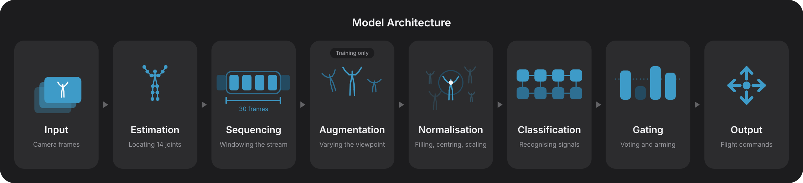

# Aerial Signal Recognition

Aerial Signal Recognition identifies the aircraft-handling body signals of a person on the ground from the camera of an unmanned aerial vehicle (UAV), and decides when the UAV should act on them. Body keypoints from any 2D pose estimator are sequenced into short windows, normalised to the body and classified by a two-layer LSTM trained with viewpoint augmentation. A gate then turns recognised signals into flight commands only after an attention signal and a stable vote over recent windows. The repository contains the recogniser, its trained weights, a live demo and every experiment of the accompanying IEEE USYS 2026 paper.


[](#citation)
[](LICENSE)
[](https://github.com/iamabdirazak/aerial-signal-recognition/releases)
[](#getting-started)

## Overview

In search and rescue, a responder may need a UAV to hover, change altitude, land or abort when no radio or controller is at hand. Ground crews already direct aircraft with standard body signals, and this project recognises 13 of them from the UAV's own camera.

Because the recogniser works on 14 body keypoints rather than images, it runs with any 2D pose estimator, at any frame rate, in about 2 ms per decision on a CPU.

## How it works



Each stage is one file in [`model/`](model).

| Stage | What it does | File |
|:--|:--|:--|
| Sequencing | Every 0.2 s, the last 30 frames (1.2 s) form one window | [`sequencing.py`](model/sequencing.py) |
| Augmentation | In training only, shows each window as a UAV might have seen it, tilted, rolled, with missing joints or at a lower frame rate | [`augmentation.py`](model/augmentation.py) |
| Normalisation | Fills missing joints, centres the body on the neck, scales it by torso length and adds velocities | [`normalisation.py`](model/normalisation.py) |
| Classification | A two-layer LSTM with 229k parameters gives a probability for each of the 13 signals | [`classification.py`](model/classification.py) |
| Gating | Accepts a signal that wins 6 of the last 8 windows with a mean confidence of at least 0.7. The attention signal arms the gate, the next accepted signal becomes a command, and the abort signal needs no arming | [`gating.py`](model/gating.py) |

[`recogniser.py`](model/recogniser.py) joins the stages into one streaming recogniser.

## Getting started

You need Python 3.9 or later. No GPU is required.

```bash
git clone https://github.com/iamabdirazak/aerial-signal-recognition.git
cd aerial-signal-recognition
pip install -r requirements.txt
python -m pytest tests
```

The tests need no data and finish in seconds.

## Use it in your own system

Feed `Recogniser` one frame of keypoints at a time with its timestamp. It resamples to 25 Hz, classifies every 0.2 s, applies the gate and returns a command when one is accepted.

```python
from model import Recogniser

recogniser = Recogniser.from_pretrained()

for t, keypoints, visible in pose_stream():        # seconds, (14, 2) pixels, (14,) bool
    out = recogniser.push(t, keypoints, visible)
    if out and out.command:
        send_to_flight_controller(out.command)     # e.g. 'hover', 'land', 'wave_off'
```

Each result also carries the class probabilities (`out.probs`), the most likely signal (`out.signal`) and whether the gate is armed (`out.armed`).

- **Keypoints.** 14 joints in COCO body order without eyes and ears. Without a neck joint, use the midpoint of the shoulders.
- **Frame rate.** Any. Recognition holds down to about 3 fps, and `python demo/benchmark.py` times the full pipeline on your device.
- **Gate.** Pass `k`, `n` and `tau` to `from_pretrained` to make the gate stricter or more responsive.
- **Signals.** *all clear, have command* (attention), *hover, land, landing direction, move ahead, move downward, move to left, move to right, move upward, not clear, slow down, wave off* (abort).

## Live demo

The demo runs the whole pipeline on a webcam or a video file, with MediaPipe as the pose estimator.

```bash
pip install -r demo/requirements.txt
python demo/run.py                    # or --camera 1, or --video clip.mp4
```

Stand 2 to 4 m from the camera with your whole body in view. Perform the attention signal until Output shows **Ready**, then perform the signal shown in Guide. Press N or P to change signal, V to switch view, R to reset and Q to quit.

The released weights were trained on UAV footage, while the demo uses a ground-level camera and a different pose estimator, so treat it as a demonstration rather than a measure of accuracy.

## Performance

Measured offline on recorded aerial video, on people unseen in training, as the mean of five training runs.

| Measure | Result |
|:--|--:|
| Accuracy on unseen people ([UAV-GESTURE](https://asankagp.github.io/uavgesture)) | 90.5% |
| Accuracy with the camera tilted 70° down (simulated) | 85.4% |
| Accuracy on another dataset without retraining ([UAV-Human](https://sutdcv.github.io/uav-human-web/)) | 55.1% |
| Wrong actions per command stream, without and with the gate | 4.60 → 0.05 |
| Time per decision, laptop CPU | 2.1 ms |

The recogniser has not been flight-tested. It is least reliable when the signalling arms point toward a steeply angled camera, and on footage from a camera and pose estimator it was not trained with. It has no class for unrelated movement, so the gate is what keeps everyday motion from becoming commands.

## Reproducing the results

Everything about the data lives in [`data/`](data): the loaders, the evaluation folds and the scripts that fetch it. Download the UAV-GESTURE keypoints (16 MB) into that folder. The cross-dataset test also needs the skeleton data of [UAV-Human](https://sutdcv.github.io/uav-human-web/), which is available for non-commercial research and cannot be redistributed.

```bash
bash data/get_uavgesture.sh
python data/prepare_uavhuman.py ~/Downloads/Skeleton.zip data/uavhuman_skeletons.npz
bash experiments/run_all.sh
```

`run_all.sh` runs one script per section of the paper's evaluation, about four hours on a 2-core CPU.

| Section | Script |
|:--|:--|
| Recognition on unseen actors | [`recognition.py`](experiments/recognition.py), [`baselines.py`](experiments/baselines.py) |
| Viewpoint and sensor conditions | [`conditions.py`](experiments/conditions.py), [`viewpoint.py`](experiments/viewpoint.py) |
| Command streams and gating | [`gating.py`](experiments/gating.py) |
| Cross-dataset evaluation | [`cross_dataset.py`](experiments/cross_dataset.py) |
| Dataset, model size and speed | [`dataset.py`](experiments/dataset.py), [`benchmark.py`](experiments/benchmark.py) |

Every model is tested on actors held out from training, in the three folds of [`protocol.py`](data/protocol.py). The outputs behind the paper are in [`results/runs`](results/runs), summarised in [`results/paper.json`](results/paper.json).

## Citation

This repository accompanies the paper *Toward Viewpoint-Robust Body-Signal Recognition for Commanding UAVs in Search and Rescue*, presented at IEEE USYS 2026. The link will be added once the proceedings are published.

```bibtex
@inproceedings{muhumed2026viewpoint,
  title     = {Toward Viewpoint-Robust Body-Signal Recognition for Commanding {UAVs} in Search and Rescue},
  author    = {Muhumed, Abdirisak Mubarik and Sariff, Nohaidda and Saruchi, Sarah 'Atifah and Mohd Tahir, Noor Idayu},
  booktitle = {IEEE International Conference on Underwater System Technology: Theory and Applications (USYS)},
  year      = {2026}
}
```

## Acknowledgements

We thank A. G. Perera, Y. W. Law and J. Chahl for releasing UAV-GESTURE and its keypoints, from which the demo's reference poses are also derived, and the authors of UAV-Human for making their dataset available for research.

The code is released under the [MIT License](LICENSE). UAV-GESTURE and UAV-Human have their own terms, set by their authors.
